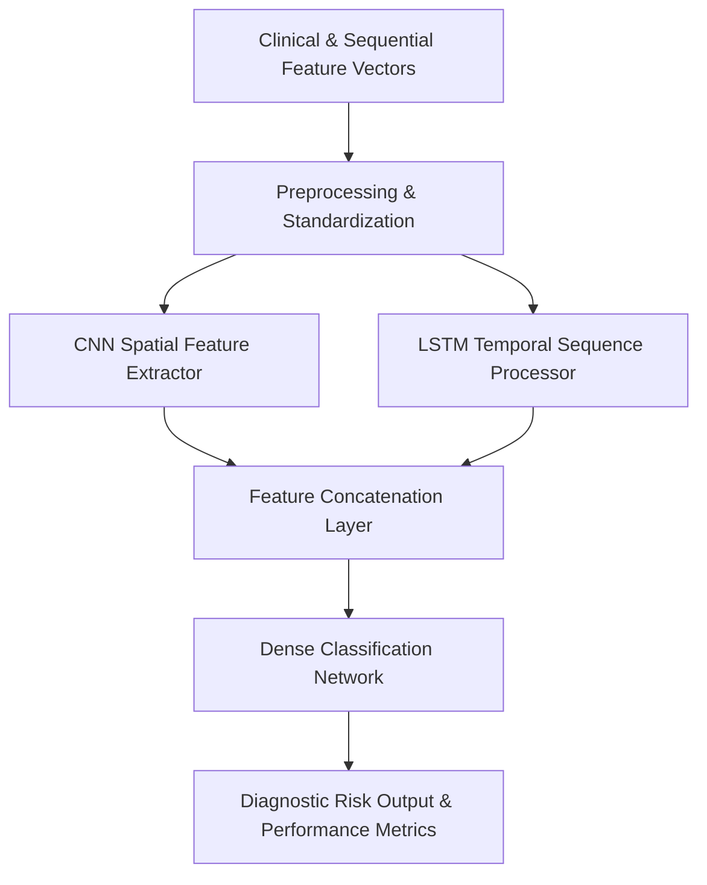

# Deep Learning CNN-LSTM Benchmark

## Overview
This repository provides a comparative deep learning framework evaluating Convolutional Neural Networks (CNN) for spatial feature extraction, Long Short-Term Memory (LSTM) networks for sequential modeling, and supervised classification for clinical cardiovascular risk prediction.

## System Architecture



## Core Features
- **Dual Architecture Benchmark**: Comparative analysis between convolutional spatial extractors and recurrent sequential networks.
- **Clinical Predictive Modeling**: Binary and multi-class classification predicting cardiovascular disease indicators.
- **Model Serialization**: Exported production weights (`best_model.pkl`) ready for integration into inference pipelines.
- **Performance Evaluation**: Comprehensive ROC-AUC curves, confusion matrices, and precision-recall benchmarks.

## Repository Structure
```
deep-learning-cnn-lstm/
|-- 01_Heart_disease_prediction/
|   |-- best_model.pkl
|   |-- heart_disease_prediction.ipynb
|   +-- heart_disease_uci.csv
|-- notebooks/
|   +-- Deep_Learning_Project_using_CNN_(Computer_Vision)_and_LSTM_(NLP).ipynb
|-- requirements.txt
+-- README.md
```

## Technology Stack
| Layer | Technologies |
| :--- | :--- |
| Frameworks | TensorFlow, Keras, PyTorch |
| Data Processing | Pandas, NumPy, Scikit-Learn |
| Serialization | Joblib, Pickle |
| Visual Diagnostics | Matplotlib, Seaborn |

## Installation & Execution
```bash
git clone https://github.com/sohailahmed-bsrh/deep-learning-cnn-lstm.git
cd deep-learning-cnn-lstm
pip install -r requirements.txt
jupyter notebook 01_Heart_disease_prediction/heart_disease_prediction.ipynb
```

## License
Distributed under the MIT License.
