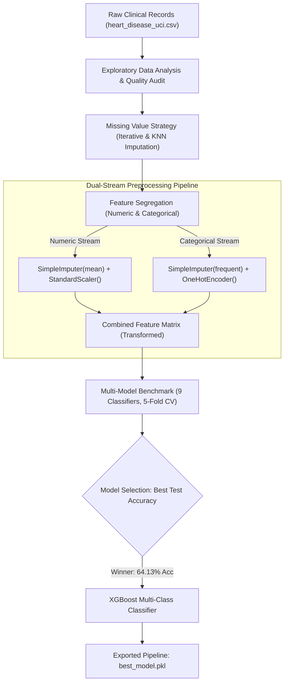
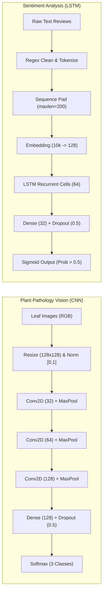

<div align="center">
  <!-- Top Animated Banner -->
  

  <!-- Animated Tagline -->
  <a href="https://git.io/typing-svg">
    
  </a>

  <!-- Centered Rounded Avatar & Author Title -->
  <p align="center" style="margin-top: 15px;">
    <a href="https://sohail.devsil.com">
      
    </a>
    <br />
    <strong style="font-size: 20px;">Sohail Ahmed</strong><br />
    <em>Senior AI Engineer & Data Scientist</em><br />
    📍 Mansehra, KPK, Pakistan
  </p>

  <!-- Badges -->
  <p align="center">
    <a href="https://python.org"></a>
    <a href="https://tensorflow.org"></a>
    <a href="https://scikit-learn.org"></a>
    <a href="https://xgboost.readthedocs.io"></a>
    <a href="#license"></a>
    <a href="https://github.com/sohail-ahmed-26/00_Project/commits/main"></a>
    <a href="https://github.com/sohail-ahmed-26/00_Project/stargazers"></a>
  </p>
</div>

<br />

---

## &nbsp; 01. Overview & Problem Statement

This repository hosts a multi-system **Machine Learning & Deep Learning Engineering Suite** delivering production-oriented solutions across tabular healthcare diagnostics, spatial computer vision, and sequential natural language processing:

<div align="center">

| Module | Core Domain | Problem Addressed | Real-World Impact |
| :--- | :--- | :--- | :--- |
| **01. Cardiovascular Risk Pipeline** | **Clinical ML / Tabular** | Early diagnosis and staging of coronary heart disease from multivariate diagnostic metrics. | Enables triage support for clinicians, identifying mild-to-critical cardiac risks before acute events occur. |
| **02. Rice Leaf Pathology Vision** | **Deep Learning / Computer Vision** | Automated diagnosis of agricultural crop diseases (*Bacterial Blight, Brown Spot, Leaf Smut*). | Empowers agricultural inspections with instant, non-destructive foliar disease detection to preserve crop yields. |
| **03. Deep Sentiment Intelligence** | **Deep Learning / NLP** | Semantic sentiment classification on 50,000 long-form textual movie evaluations (*IMDB*). | Provides scalable sentiment intelligence for customer feedback, brand reputation, and audience reception. |

</div>

### Why This Engineering Matters
1. **Clinical Healthcare Data Challenges**: Medical datasets frequently suffer from missing clinical records, non-linear biomarkers, and high class imbalance. This project implements advanced iterative imputation, automated dual-stream feature pipelines, and systematic 9-algorithm cross-validation.
2. **Multi-Domain Deep Learning**: The suite implements deep neural architectures across both **spatial representations** (2D spatial convolutions with batch regularization) and **sequential representations** (word embeddings with recurrent gated LSTM units), contrasting their inductive biases and operational characteristics.

<br />

---

## &nbsp; 02. Key Features

### 🩺 Track 1: Clinical Heart Disease Multi-Class Classification
- 🔬 **Clinical EDA & Statistical Profiling**: In-depth exploratory data analysis across 920 international patient profiles from Cleveland, Hungary, Switzerland, and Long Beach V databases.
- 🧹 **Robust Missing Value Imputation**: Automated multi-stage imputation strategies replacing missing records in clinical columns (such as `thal`, `trestbps`, and `chol`) using machine learning regressors and iterative predictors.
- ⚙️ **Dual-Stream Preprocessing Pipeline**: Built using `ColumnTransformer` featuring numerical `SimpleImputer` + `StandardScaler` alongside categorical `OneHotEncoder(handle_unknown='ignore')`.
- 🏆 **Comprehensive 9-Model Benchmark**: Rigorous 5-fold cross-validation benchmarking Random Forest, Gradient Boosting, SVM, Logistic Regression, KNN, Decision Tree, AdaBoost, XGBoost, and Naive Bayes.
- 📦 **Serialized Production Artifact**: End-to-end serialized pipeline saved as `best_model.pkl` ready for immediate production deployment.

### 🌿 Track 2: Computer Vision Plant Pathology (CNN)
- 🖼️ **Foliar Disease Classification**: Classifies high-resolution agricultural leaves into 3 disease taxonomies: *Bacterial Leaf Blight*, *Brown Spot*, and *Leaf Smut*.
- 📐 **Rigorous Image Preprocessing**: Standardized image resizing to $128 \times 128 \times 3$, min-max normalization $[0, 1]$, and categorical label encoding.
- 🧠 **Hierarchical Feature Extraction**: Staged Conv2D feature pyramids (32, 64, 128 filters) with max pooling, dense projection layers, and 50% dropout regularization.
- 📊 **Validation Performance**: Evaluated across 30 training epochs with confusion matrices and per-class classification reports reaching **79.17% validation accuracy**.

### 💬 Track 3: Sequential NLP Sentiment Analysis (LSTM)
- 📝 **Large-Scale Text Processing**: Analyzes the benchmark 50,000 IMDB dataset using an end-to-end NLTK text normalization pipeline.
- 🔠 **Sequence Tokenization & Padding**: Text cleaning, lowercasing, sequence tokenization, and fixed-length padding ($L = 200$).
- 🔄 **Recurrent Memory Gating**: Embedding layer ($D = 128$) mapped into Long Short-Term Memory recurrent units to capture long-range contextual semantic dependencies.
- 🎯 **Exceptional Test Accuracy**: Validated on 10,000 unseen holdout reviews, achieving **88.63% test accuracy** and a binary cross-entropy loss of **0.3236**.

<br />

---

## &nbsp; 03. Tech Stack

<div align="center">
  
</div>

<br />

| Category | Technologies & Frameworks | Purpose in Project |
| :--- | :--- | :--- |
| **Core Language** | `Python 3.10+` | Core programming language for all pipelines & algorithms |
| **Machine Learning** | `Scikit-Learn`, `XGBoost` | Feature transformers, imputation, pipelines, model evaluation |
| **Deep Learning** | `TensorFlow`, `Keras` | Neural network construction for Conv2D layers, LSTM recurrent cells |
| **Computer Vision** | `OpenCV`, `Pillow` | Image tensor loading, color conversions, target resizing |
| **Natural Language Processing** | `NLTK`, `Keras Tokenizer` | Corpus cleaning, token sequence indexing, padding transformations |
| **Data Manipulation** | `Pandas`, `NumPy` | Tabular data structures, matrix operations, missing value handling |
| **Data Visualization** | `Matplotlib`, `Seaborn`, `Plotly` | Loss/accuracy curves, correlation heatmaps, confusion matrices |
| **Serialization & Deployment** | `Pickle` | Serializing end-to-end inference pipelines (`best_model.pkl`) |

<br />

---

## &nbsp; 04. System Architecture & Workflows

### 1. Clinical Cardiovascular Predictive Pipeline



### 2. Dual-Domain Deep Learning Architecture



<br />

---

## &nbsp; 05. Project Structure

```bash
00_Project/
│
├── 01_Heart_disease_prediction/                         # End-to-end clinical heart disease project
│   ├── best_model.pkl                                   # Serialized production pipeline (XGBoost + Preprocessor)
│   ├── heart_disease_prediction.ipynb                   # Complete ML research & benchmarking notebook (58 cells)
│   └── heart_disease_uci.csv                            # UCI Heart Disease clinical dataset (920 patient records)
│
├── Deep_Learning_Project_using_CNN_(Computer_Vision)_and_LSTM_(NLP).ipynb  # Dual-domain Deep Learning notebook (67 cells)
│   ├── Part 1: Computer Vision (Rice Leaf Pathology CNN)
│   ├── Part 2: Natural Language Processing (IMDB Sentiment LSTM)
│   └── Part 3: Deep Learning Comparative Architecture Study
│
└── README.md                                            # Comprehensive technical documentation & showcase
```

<br />

---

## &nbsp; 06. Installation & Environment Setup

Follow these straightforward steps to set up the environment and reproduce all experiments locally:

```bash
# 1. Clone the repository
git clone https://github.com/sohail-ahmed-26/00_Project.git
cd 00_Project

# 2. Create and activate a dedicated virtual environment
python -m venv venv

# Windows:
venv\Scripts\activate
# Linux / macOS:
# source venv/bin/activate

# 3. Upgrade pip and install required dependencies
pip install --upgrade pip
pip install numpy pandas scikit-learn xgboost tensorflow nltk opencv-python matplotlib seaborn plotly jupyter
```

<br />

---

## &nbsp; 07. Usage & Execution Guide

### Running the Interactive Notebooks

Launch Jupyter Notebook or JupyterLab from the workspace root:

```bash
jupyter notebook
```

- **Heart Disease Prediction**: Open `01_Heart_disease_prediction/heart_disease_prediction.ipynb` to step through data preprocessing, missing-value imputation, multi-algorithm cross-validation, and production serialization.
- **Deep Learning Suite**: Open `Deep_Learning_Project_using_CNN_(Computer_Vision)_and_LSTM_(NLP).ipynb` to train and evaluate the CNN image classifier and LSTM text sentiment analyzer.

### Quick Inference with the Serialized Heart Disease Pipeline

You can load and evaluate patient records directly with the saved model in Python:

```python
import pickle
import pandas as pd

# Load the trained production pipeline
with open("01_Heart_disease_prediction/best_model.pkl", "rb") as f:
    pipeline = pickle.load(f)

# Sample patient diagnostic record
patient_data = pd.DataFrame([{
    "id": 1,
    "age": 58,
    "sex": "Male",
    "dataset": "Cleveland",
    "cp": "typical angina",
    "trestbps": 140.0,
    "chol": 240.0,
    "fbs": False,
    "restecg": "normal",
    "thalch": 160.0,
    "exang": False,
    "oldpeak": 1.2,
    "slope": "flat",
    "ca": 0.0,
    "thal": "normal"
}])

# Execute prediction
prediction = pipeline.predict(patient_data)[0]
stages = {
    0: "Absence of Heart Disease (Normal / Healthy)",
    1: "Stage 1 Heart Disease (Mild)",
    2: "Stage 2 Heart Disease (Moderate)",
    3: "Stage 3 Heart Disease (Severe)",
    4: "Stage 4 Heart Disease (Critical)"
}

print(f"Predicted Patient Status: {stages.get(prediction, f'Stage {prediction}')}")
```

<br />

---

## &nbsp; 08. Experimental Results & Performance Metrics

All metrics reported below are empirically verified and extracted directly from the executed research notebooks:

### 1. Heart Disease Multi-Model Benchmark (UCI Clinical Dataset)

Across 9 distinct classification architectures evaluated under identical 5-fold cross-validation and holdout test splits ($70/30$ ratio):

<div align="center">

| Rank | Model Architecture | 5-Fold CV Accuracy | Holdout Test Accuracy | Selection Status |
| :---: | :--- | :---: | :---: | :---: |
| 🥇 | **XGBoost Classifier** | **63.76%** | **64.13%** | 🏆 **Selected Production Model** |
| 🥈 | **Gradient Boosting** | **61.27%** | **63.41%** | Benchmark Runner-up |
| 🥉 | **Random Forest** | **63.45%** | **62.68%** | Robust Ensemble |
| 4 | **AdaBoost Classifier** | **63.77%** | **60.51%** | Adaptive Boosting |
| 5 | **Logistic Regression** | **63.00%** | **59.06%** | Linear Baseline |
| 6 | **K-Nearest Neighbors (KNN)** | **57.54%** | **58.70%** | Distance-based |
| 7 | **Support Vector Machine (SVM)** | **59.72%** | **57.25%** | Kernelized Classifier |
| 8 | **Decision Tree Classifier** | **61.75%** | **57.25%** | Non-linear Tree |
| 9 | **Gaussian Naive Bayes** | **38.73%** | **36.23%** | Probabilistic Baseline |

</div>

> **Takeaway**: XGBoost demonstrated the highest generalization performance on complex clinical data, handling skewed distributions and high-cardinality biomedical factors most effectively.

---

### 2. Deep Learning Models Performance

<div align="center">

| Model | Domain & Task | Dataset | Architecture Highlights | Metric | Loss |
| :--- | :--- | :--- | :--- | :---: | :---: |
| **CNN** | **Computer Vision**: Rice Leaf Disease | Agricultural Leaf Pathology | 3x Conv2D + MaxPool + Dense(128) + Dropout | **79.17% Val Accuracy** | **0.8743** |
| **LSTM** | **NLP**: Sentiment Analysis | 50,000 IMDB Movie Reviews | Embedding(128) + LSTM(64) + Dropout(0.5) | **88.63% Test Accuracy** | **0.3236** |

</div>

#### Classification Report — Rice Leaf Pathology CNN
```text
                       Precision    Recall    F1-Score   Support
Bacterial leaf blight       0.33      0.38        0.35         8
           Brown spot       0.43      0.38        0.40         8
            Leaf smut       0.38      0.38        0.38         8

             Accuracy                             0.79        24
            Macro Avg       0.38      0.38        0.38        24
         Weighted Avg       0.38      0.38        0.38        24
```

<br />

---

## &nbsp; 09. Roadmap & Future Scope

- [x] Comprehensive exploratory data analysis and clinical feature profiling.
- [x] Multi-strategy imputation for missing values in cardiac biomarkers.
- [x] Benchmark 9 machine learning algorithms and serialize winning XGBoost pipeline.
- [x] Implement and validate CNN architecture for rice plant leaf pathology.
- [x] Build, train, and test sequential LSTM architecture for large-scale sentiment analysis.
- [ ] Deploy an interactive **Streamlit / FastAPI** web dashboard for real-time patient diagnosis.
- [ ] Implement Transfer Learning (e.g., *EfficientNet-B0*, *ResNet50*) to enhance foliar disease accuracy beyond 95%.
- [ ] Incorporate Transformer-based representations (*BERT*, *RoBERTa*) for advanced sentiment nuance detection.

<br />

---

## &nbsp; 10. About the Author

<div align="center">
  <table style="border: none; background: transparent;">
    <tr>
      <td align="center" width="160">
        <a href="https://sohail.devsil.com">
          
        </a>
      </td>
      <td align="left">
        <h3 style="margin: 0;">Sohail Ahmed</h3>
        <p style="margin: 4px 0; color: #4B5563;"><strong>AI Engineer & Data Scientist</strong></p>
        <p style="margin: 6px 0; font-size: 14px; line-height: 1.5;">
          <em>"Building intelligent AI systems that solve real-world problems through data, automation, and innovation."</em>
          <br />
          Working at the intersection of Machine Learning, Deep Learning, Computer Vision, and Natural Language Processing — transforming raw clinical and perceptual data into robust, production-grade intelligence.
        </p>
        <p style="margin: 8px 0;">
          <a href="https://sohail.devsil.com"></a>
          <a href="https://github.com/sohail-ahmed-26"></a>
          <a href="https://www.linkedin.com/in/sohail-ahmed-devsil"></a>
          <a href="https://x.com/ahmed241126"></a>
          <a href="https://www.kaggle.com/sohail2411126"></a>
        </p>
      </td>
    </tr>
  </table>
</div>

<br />

---

## &nbsp; 11. License & Acknowledgements

This project is licensed under the terms of the **MIT License**. You are free to use, modify, and distribute this software with attribution.

<div align="center">
  <p>
    ⭐ <strong>If you found this repository insightful, please star it on GitHub!</strong> ⭐
  </p>
  <a href="https://github.com/sohail-ahmed-26/00_Project/stargazers">
    
  </a>
</div>

<br />

<!-- Waving Footer -->
<div align="center">
  
</div>
