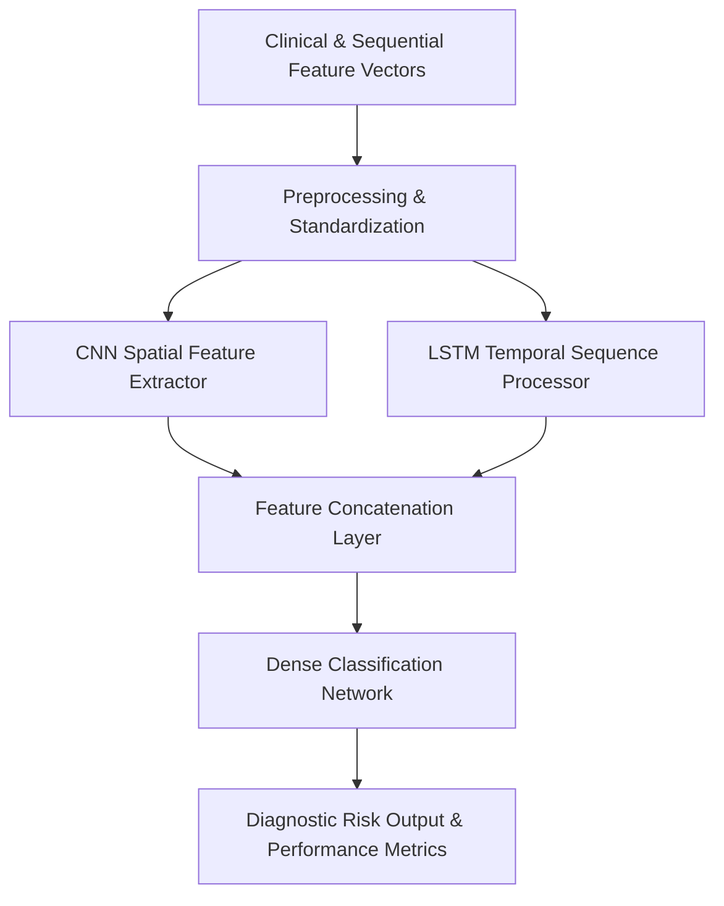

# Deep Learning CNN-LSTM Benchmark

## Overview
This repository provides a comparative deep learning framework evaluating Convolutional Neural Networks (CNN) for spatial feature extraction, Long Short-Term Memory (LSTM) networks for sequential modeling, and supervised classification for clinical cardiovascular risk prediction.

## System Architecture



## Core Features
- **Dual Architecture Benchmark**: Comparative analysis between convolutional spatial extractors and recurrent sequential networks.
- **Clinical Predictive Modeling**: Binary and multi-class classification predicting cardiovascular disease indicators.
- **Model Serialization**: Exported production weights (`best_model.pkl`) ready for integration into inference pipelines.
- **Performance Evaluation**: Comprehensive ROC-AUC curves, confusion matrices, and precision-recall benchmarks.

## Repository Structure
```
deep-learning-cnn-lstm/
|-- 01_Heart_disease_prediction/
|   |-- best_model.pkl
|   |-- heart_disease_prediction.ipynb
|   +-- heart_disease_uci.csv
|-- notebooks/
|   +-- Deep_Learning_Project_using_CNN_(Computer_Vision)_and_LSTM_(NLP).ipynb
|-- requirements.txt
+-- README.md
```

## Technology Stack
| Layer | Technologies |
| :--- | :--- |
| Frameworks | TensorFlow, Keras, PyTorch |
| Data Processing | Pandas, NumPy, Scikit-Learn |
| Serialization | Joblib, Pickle |
| Visual Diagnostics | Matplotlib, Seaborn |

## Installation & Execution
```bash
git clone https://github.com/sohailahmed-bsrh/deep-learning-cnn-lstm.git
cd deep-learning-cnn-lstm
pip install -r requirements.txt
jupyter notebook 01_Heart_disease_prediction/heart_disease_prediction.ipynb
```

---

## Author & Contact Information

<table width="100%" align="center">
  <tr>
    <td align="center" style="padding: 20px;">
      <h3>Sohail Ahmed</h3>
      <p><strong>Full-Stack Artificial Intelligence & Computer Vision Engineer</strong></p>
      <p>
        <a href="https://sohail.devsil.com"></a>
        <a href="https://github.com/sohailahmed-bsrh"></a>
        <a href="https://linkedin.com/in/sohail-ahmed-dev"></a>
        <a href="mailto:sohail.bsrh@gmail.com"></a>
      </p>
      <p><em>Available for technical roles in Artificial Intelligence, Computer Vision, and Full-Stack Engineering.</em></p>
      <hr style="border: 0; height: 1px; background: #30363d; margin: 15px 0;">
      <small>Distributed under the MIT License.</small>
    </td>
  </tr>
</table>
